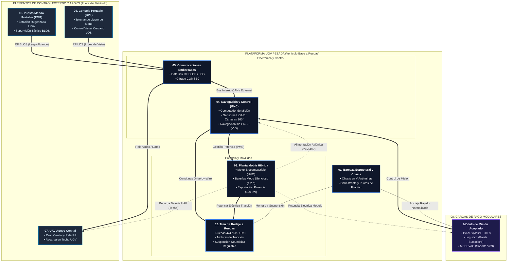

# Modelo Modular de UGV Terrestre Pesado Dual en SysML v2

Este repositorio contiene la arquitectura formal de ingeniería de sistemas (MBSE) para un **UGV (Unmanned Ground Vehicle) Terrestre Pesado Multipropósito de uso Dual (Civil-Militar)** desarrollado según la especificación **OMG SysML v2** y adaptado a las prescripciones técnicas del pliego del **CDTI**.

El modelo se centra en la plataforma de ruedas (Lote 1: tracción 4x4, 6x6 u 8x8) y su integración en el **Sistema de Interés (SoI)** completo junto con sus puestos de control, dron cenital y módulos de misión.

---

## 1. Estructura de Archivos Modulares (`Modelos/`)

Siguiendo el principio de diseño modular y baja sobrecarga cognitiva, el modelo se distribuye en **11 archivos independientes**, cada uno con su propio espacio de nombres (`package`) y acoplados mediante directivas de importación (`private import`):

```text
Modelos/
├── 00_tipos_base.sysml          <- Magnitudes físicas (Masa, Potencia) y puertos estándar (Mecánico, Potencia, Bus, RF)
├── 01_barcaza.sysml             <- Barcaza estructural, chasis en V, cabestrante y puntos de anclaje (RGEN-02..05)
├── 02_tren_rodaje.sysml         <- Tren de ruedas independientes, suspensión regulable y servodirección (RLT1-01..05)
├── 03_planta_motriz.sysml       <- Planta híbrida: biocombustible 100%, baterías silenciosas y exportación 120kW (RGEN-11..19)
├── 04_navegacion_control.sysml  <- Cerebro GNC: autonomía waypoints, Follow-Me, Detect & Avoid y sensores 360° (ROPE, RNAV)
├── 05_comunicaciones.sysml      <- Comunicaciones tácticas BLOS/LOS con cifrado COMSEC (RCOM-01..03)
├── 06_estaciones_control.sysml  <- Puesto de Mando Portable (PMP - Linux) y Consola Ligera (CPT - LOS)
├── 07_uav_cenital.sysml         <- Dron aéreo de exploración y relé de comunicaciones con base en techo
├── 08_cargas_pago.sysml         <- Cargas de misión modulares: ISTAR (mástil), Logístico (palets) y MEDEVAC (heridos)
├── 09_sistema_ugv.sysml         <- Ensamblado principal (SoI), conexiones internas (IBD) y relaciones de acople
└── 10_comportamiento.sysml      <- Máquina de estados de los modos operativos (Teleoperado, Autónomo, Sigiloso, Degradado)
```

---

## 2. Tabla de Subsistemas y Paquetes

| Archivo | Paquete SysML v2 | Contenido y Elementos Clave | Dependencias |
| :--- | :--- | :--- | :--- |
| [`00_tipos_base.sysml`](Modelos/00_tipos_base.sysml) | `TiposBase` | Magnitudes (`Masa`, `Potencia`, `Tension`), puertos (`MechanicalMountPort`, `ElectricalPowerPort`, `DataBusPort`, `RFPort`) | `ScalarValues::*` |
| [`01_barcaza.sysml`](Modelos/01_barcaza.sysml) | `SubsistemaBarcaza` | `BarcazaEstructural` con chasis en V, cabestrante y 3 interfaces de anclaje (Frontal/Superior/Trasero). Requisito `ReqMasaTaraPlataforma` (3500-5000 kg). | `TiposBase::*` |
| [`02_tren_rodaje.sysml`](Modelos/02_tren_rodaje.sysml) | `SubsistemaTrenRodaje` | `TrenRodajeRuedas` (ruedas independientes, suspensión neumática regulable y retráctil). Requisito `ReqSuspensionRegulable`. | `TiposBase::*` |
| [`03_planta_motriz.sysml`](Modelos/03_planta_motriz.sysml) | `SubsistemaPlantaMotriz` | `PlantaMotrizHibrida` (motor 100% biocombustible, baterías modo silencioso ≥ 2 h, PMS, exportación 120 kW). Requisitos `ReqPotenciaMinimaPlataforma` (≥ 140 kW) y `ReqExportacionEnergia`. | `TiposBase::*` |
| [`04_navegacion_control.sysml`](Modelos/04_navegacion_control.sysml) | `SubsistemaNavegacionControl` | `SistemaNavegacionControl` (autonomía waypoints, Follow-Me, Detect & Avoid, odometría visual/inercial VIO para GNSS denegado, cámaras 360°, térmica y LiDAR). | `TiposBase::*` |
| [`05_comunicaciones.sysml`](Modelos/05_comunicaciones.sysml) | `SubsistemaComunicaciones` | `SistemaComunicacionesEmbarcado` (enlaces de datos RF BLOS y LOS, cifrado militar COMSEC, antenas). | `TiposBase::*` |
| [`06_estaciones_control.sysml`](Modelos/06_estaciones_control.sysml) | `SubsistemaEstacionesControl` | `PuestoMandoPortable` (PMP - estación rugerizada Linux BLOS) y `ConsolaPortableCPT` (CPT - telemando de mano LOS). | `TiposBase::*` |
| [`07_uav_cenital.sysml`](Modelos/07_uav_cenital.sysml) | `SubsistemaUAVCenital` | `UAVApoyoCenital` (dron aéreo de reconocimiento y relé de comunicaciones; base de aterrizaje y recarga en techo). | `TiposBase::*` |
| [`08_cargas_pago.sysml`](Modelos/08_cargas_pago.sysml) | `SubsistemaCargasPago` | `CargaPagoModular` con especializaciones: `Modulo_ISTAR`, `Modulo_Logistico`, `Modulo_MEDEVAC`. Requisito `ReqCapacidadCargaUtilPlataforma` (≥ 2000 kg). | `TiposBase::*` |
| [`09_sistema_ugv.sysml`](Modelos/09_sistema_ugv.sysml) | `SistemaUGV` | Ensamblado `PlataformaUGV` e integración completa del `SistemaUGVPesadoDual` (SoI). Conexiones mecánicas, eléctricas, de datos y RF. | Paquetes `00` a `08` |
| [`10_comportamiento.sysml`](Modelos/10_comportamiento.sysml) | `ComportamientoUGV` | `ModosOperacionUGVStateMachine` (`Apagado`, `ModoTeleoperado`, `ModoAutonomo`, `ModoSigiloso`, `ModoDegradado`). | Ninguna |

---

## 3. Arquitectura Gráfica del Sistema

A continuación se muestra el diagrama de arquitectura física y funcional del UGV pesando sus interconexiones de **Información/Datos**, **Potencia/Energía** y **Sustentación Mecánica**:


> 💡 **Visor interactivo con filtros de capas**: Puedes abrir el archivo [`Vistas graficas/index.html`](Vistas%20graficas/index.html) directamente en el navegador para activar/desactivar dinámicamente cada tipo de flujo.

### Diagrama de Bloques y Conexiones (Mermaid)



---

## 4. Topología de Conexiones (Internal Block Diagram - IBD)

El archivo [`09_sistema_ugv.sysml`](Modelos/09_sistema_ugv.sysml) orquesta las tres redes de enlace del sistema:

1. **Red de Información / Control (Azul)**:
   * Puesto de Mando (PMP) $\xrightarrow{\text{RF BLOS}}$ Comunicaciones $\xrightarrow{\text{Bus CAN}}$ Navegación y Control (GNC).
   * Consola Ligera (CPT) $\xrightarrow{\text{RF LOS}}$ Comunicaciones.
   * Navegación y Control $\xrightarrow{\text{Drive-by-Wire}}$ Tren de Rodaje (dirección, aceleración y frenada).
   * Navegación y Control $\xrightarrow{\text{Datos Misión}}$ Carga de Pago instalada.
2. **Red de Potencia y Energía (Verde)**:
   * Planta Motriz Híbrida $\xrightarrow{\text{Alta Tensión}}$ Motores eléctricos de tracción en Tren de Rodaje.
   * Planta Motriz Híbrida $\xrightarrow{\text{Aviónica 24V/48V}}$ Sensores y Computador GNC.
   * Planta Motriz Híbrida $\xrightarrow{\text{Potencia Módulo}}$ Carga de Pago instalada.
   * Planta Motriz Híbrida $\xrightarrow{\text{Recarga Techo}}$ Baterías del UAV Cenital.
3. **Red Estructural / Mecánica (Ámbar)**:
   * Barcaza Común sostiene mecánicamente el tren de rodaje, la planta motriz y la aviónica.
   * Interfaces normalizadas (Frontal / Superior / Trasera) aseguran la fijación rápida de cargas de pago y hangar del UAV.

---

## 5. Visualización Gráfica Interactiva

En la carpeta [`Vistas graficas/`](Vistas%20graficas/) se incluye el visor interactivo de arquitectura:

* **Abrir en navegador**: Abrir [`Vistas graficas/index.html`](Vistas%20graficas/index.html) para explorar los componentes con botones de filtrado interactivo por tipo de flujo (Datos, Energía y Mecánica).

---

## 6. Trazabilidad con el Pliego del CDTI

Cada definición incluye docstrings formales que trazan los requisitos contractuales:
* `RGEN-02..05`: Barcaza común modular y concepción robótica nativa.
* `RLT1-01..10`: Movilidad a ruedas (4x4/6x6/8x8), suspensión activa y capacidad de carga útil $\ge 2.000\text{ kg}$.
* `RGEN-11..19`: Planta híbrida 100% biocombustible, modo silencioso $\ge 2\text{ h}$ y exportación $\ge 120\text{ kW}$.
* `ROPE-01..06`: Puesto de mando BLOS, consola CPT LOS, navegación por waypoints y Follow-Me.
* `RNAV-01`: Navegación en entornos de GNSS denegado mediante odometría visual inercial (VIO / LiDAR SLAM).
